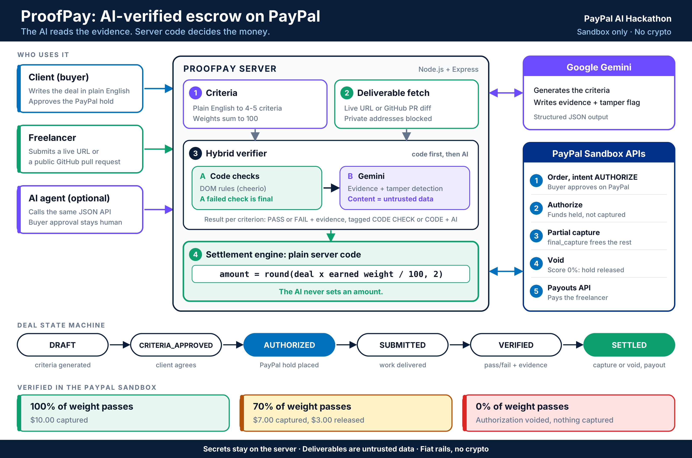

# ProofPay

**AI-verified escrow on PayPal. Money moves in proportion to verified work, and no code path lets the AI set an amount.**

Built for the **PayPal AI Hackathon**. PayPal sandbox only. No cryptocurrency.

| | |
|---|---|
| Live demo | https://proofpay.ai.studio/ |
| Demo video (under 3 min) | https://youtu.be/cIyjly1gjQw?si=udWPeTJJ-qwm_Qyi |
| License | MIT |

---
   


## The problem

Freelance work is paid on trust. The client worries they will pay for work that does not match the brief. The freelancer worries they will finish the work and not be paid. Today the usual answers are a platform that takes a cut to referee, or an argument after the fact.

ProofPay replaces "trust me" with three things written down before any money moves: the agreed criteria, the amount on hold, and the rule that turns verified results into a payout.

## What it does

1. **Agree.** The client writes the deal in plain English. AI turns it into 4 to 5 objectively checkable criteria with weights that sum to 100. Both sides see them before funding.
2. **Hold.** The client approves a PayPal **authorization** for the full amount. Funds are reserved, not captured.
3. **Deliver.** The freelancer submits a live URL or a public GitHub pull request.
4. **Verify.** A hybrid verifier checks the deliverable against each criterion and returns pass or fail with evidence.
5. **Settle.** Server code computes the payout from the weights. PayPal captures exactly that amount, releases the rest, and the captured amount is sent to the freelancer with PayPal Payouts. A fully failed deal voids the authorization.

```
 Client            ProofPay server               PayPal sandbox           Freelancer
   |  deal text         |                              |                      |
   |------------------->|  criteria (AI, JSON)         |                      |
   |  approve criteria  |                              |                      |
   |------------------->|  create order (AUTHORIZE) -->|                      |
   |<-- approval link --|                              |                      |
   |  approve in PayPal ------------------------------>|                      |
   |                    |  authorize order ----------->|  funds held          |
   |                    |<-----------------------------|                      |
   |                    |                  submit URL / PR <------------------|
   |                    |  code checks, then AI evidence                      |
   |                    |  amount = deal x earned weight / 100 (server code)  |
   |                    |  capture(amount, final_capture) ->|                 |
   |                    |  payout(amount) ------------------------------------>|
```

## Why this is different

Several AI-verified escrow projects exist. To our knowledge the ones we found settle in crypto. ProofPay's choices are:

1. **Fiat rails, no wallet.** It runs on PayPal Orders, Payments and Payouts, so a client or freelancer needs only a PayPal account.
2. **Proportional settlement from a single hold.** One authorization is partially captured with `final_capture: true`. The unused remainder is released by PayPal, not by a second call we have to get right. A fully failed deal is voided.
3. **The AI cannot move money.** The model returns pass or fail plus evidence. The payout is `round(amount x earned_weight / 100, 2)` computed in server code. There is no path from model output to an amount.
4. **Code checks gate the AI.** For web deliverables, deterministic DOM checks run first. A criterion that fails its code check cannot be passed by the model, so an empty `<form>` does not earn credit. The model adds evidence for criteria that code cannot judge.
5. **Tamper detection.** Submitted content is treated as untrusted data. Text addressed to the verifier or "system" is ignored, and the result screen shows a visible warning when it is found.
6. **Built for agents as well as people.** Every step is a JSON endpoint, so an AI agent can create a deal, submit work and trigger verification. The one human step is PayPal's buyer approval, which PayPal requires.
7. **It states its own limits.** See [Limitations](#limitations-stated-plainly).

## Verified in the PayPal sandbox

These runs were performed on the deployed app with sandbox accounts.

| Deliverable | Score | Result |
|---|---|---|
| Page with all four elements | 100% | $10.00 captured |
| Page missing the contact form | 70% | $7.00 captured, $3.00 released. PayPal reports the authorization as `CAPTURED` with the remainder released |
| `https://example.com` | 0% | Authorization voided, nothing captured |
| Page with hidden instructions to the verifier and no real content | 0% | Tamper warning shown, nothing captured |

Payouts: the final version returns a PayPal payout batch id for the freelancer payment. Capture and payout ids are shown in the settlement ledger inside the app. Only ids returned by PayPal are displayed.

## Agent-friendly API

| Method and path | Purpose |
|---|---|
| `POST /api/deals` | Create a deal from `{ "dealText": "...", "amount": 10 }`. Returns the deal and its criteria |
| `GET /api/deals/:id` | Read the full deal: state, criteria, ledger |
| `POST /api/deals/:id/approve` | Approve criteria and get the PayPal approval link for the buyer |
| `GET /api/paypal/return` | PayPal redirects here after approval. The server authorizes the order |
| `POST /api/deals/:id/submit` | Submit `{ "url": "..." }`, a live page or a public GitHub PR |
| `POST /api/deals/:id/verify` | Run verification and settle |

```bash
curl -X POST <DEPLOYED_URL>/api/deals \
  -H "Content-Type: application/json" \
  -d '{"dealText":"Pay $10 for a one-page landing page with a hero section, a pricing section and a contact form","amount":10}'
```

Deal states: `DRAFT` to `CRITERIA_APPROVED` to `AUTHORIZED` to `SUBMITTED` to `VERIFIED` to `SETTLED`.

## How verification works

```
 deliverable  -->  fetch (20 s timeout, 40,000 character limit, localhost and private addresses rejected)
                       |
                       v
              deterministic DOM checks (cheerio)      GitHub PRs: diff goes to the AI step only
                       |  a failed code check is final
                       v
              Gemini 2.5 Flash, JSON output, temperature 0
              content marked untrusted, embedded instructions ignored
                       |
                       v
         per-criterion result: PASS or FAIL, evidence, source (CODE CHECK or CODE + AI)
                       |
                       v
              server code: earned weight, payout amount
```

## PayPal integration

| Step | API call |
|---|---|
| Authenticate | `POST /v1/oauth2/token` |
| Hold funds | `POST /v2/checkout/orders` with `intent: AUTHORIZE` |
| Buyer approval | Redirect to the `payer-action` link, then return to the app |
| Confirm hold | `POST /v2/checkout/orders/{id}/authorize` |
| Partial release | `POST /v2/payments/authorizations/{id}/capture` with `amount` and `final_capture: true` |
| Full refund of the hold | `POST /v2/payments/authorizations/{id}/void` |
| Pay the freelancer | `POST /v1/payments/payouts` |

Every POST carries a unique `PayPal-Request-Id`. Full PayPal error bodies are logged on the server and a readable message is shown in the UI.

## Architecture

- **Server:** Node.js and Express. All PayPal and Gemini calls run here. No key reaches the browser.
- **Frontend:** single page, one deal view, mobile friendly.
- **AI:** Gemini 2.5 Flash for criteria extraction and evidence.
- **Storage:** in memory. Deals are lost on restart (see limitations).
- **Built with:** Google AI Studio for scaffolding, then hardened by hand through testing.

## Run it yourself

Requirements: Node.js 18 or later, a PayPal developer account, a Gemini API key.

1. Clone the repo and run `npm install`.
2. Copy `.env.example` to `.env` and fill in the values.
3. In the PayPal developer dashboard, create a sandbox REST app and **tick Payouts under Features**.
4. Create **three US sandbox accounts**: a Business account (the platform), a Personal account (the buyer) and a Personal account (the freelancer). Put the freelancer's email in `FREELANCER_EMAIL`.
5. Start the app with `npm run dev`. It serves on `http://localhost:3000`. For a production build use `npm run build` and then `npm start`.
6. Choose **Load Demo Deal**, approve and fund with the buyer account, then submit one of the built-in sample deliverables (complete page, page missing the contact form, or an adversarial page with hidden instructions) or your own URL, and verify.

| Variable | Meaning |
|---|---|
| `PAYPAL_CLIENT_ID` | Sandbox REST app client id |
| `PAYPAL_SECRET` | Sandbox REST app secret |
| `GEMINI_API_KEY` | Gemini API key |
| `FREELANCER_EMAIL` | Email of the freelancer sandbox account |
| `APP_URL` (or `APP_BASE_URL`) | Public address of the deployed app, used for the PayPal return link |

**Setup lesson:** sandbox accounts created for India rejected USD payments with "This seller doesn't accept payments in your currency." Create the sandbox accounts with country set to United States.

Never commit `.env`. The repo ships `.env.example` only.

## Limitations, stated plainly

- **A hold, not custody.** ProofPay uses a PayPal authorization. That reserves the buyer's funding source. It is not a true escrow account, and a hold can fail at capture time if the buyer's situation changes.
- **Authorization window.** PayPal authorizations have a short honor period (typically 3 days) and a 29-day validity. Long engagements need re-authorization or a different PayPal product.
- **Static checks only.** The verifier reads page source or a code diff. It checks that things exist, not that they work or look right. Passing the DOM checks does not prove quality.
- **No dispute path.** There is no human override, and a buyer could still open a PayPal dispute after capture.
- **Buyer approval is human.** PayPal requires the buyer to approve the payment, so an agent cannot complete funding alone.
- **In-memory storage.** Deals are lost on server restart.
- **AI quota.** If the Gemini API quota is exhausted, the app falls back to generic criteria and code-only checks, while PayPal authorization, capture, void and payout run unchanged.
- **Sandbox only.** No real money moves.
- **Demo shortcut.** A "Simulate Sandbox Authorization" button marks a deal as authorized without a PayPal hold, so the flow can be tried without a PayPal login. A run that uses it is not a real PayPal hold. Use the PayPal approval path for any run you want to treat as real.

## What production would need

A database, PayPal webhooks for payment events, a marketplace or platform payment product with delayed disbursement (confirm current availability in PayPal's documentation), human dispute review, rendered-page and browser-based checks (screenshots, mobile viewport, accessibility), re-authorization handling, and audit logs for every decision.

## Design decisions

- **Authorization instead of a custody account.** It is the strongest primitive available to a developer in the sandbox without partner onboarding, and it makes partial release a single call.
- **Server code owns the money.** A model is good at reading evidence and bad at being accountable for amounts. The split makes the system auditable: the same inputs always give the same payout.
- **Code before AI.** Deterministic checks are cheap, repeatable and not persuadable. The model is used where judgment is needed and fenced where it is not.
- **Fail closed.** If the verifier cannot tell, the criterion fails and says so.

## Author

**Shital Parab**, AI systems engineer, Mumbai.

- LinkedIn: https://www.linkedin.com/in/shital-parab-054751300
- GitHub: https://github.com/Shital24650
- Devpost: https://devpost.com/shitalparab2605

## License

MIT. See [LICENSE](LICENSE).
